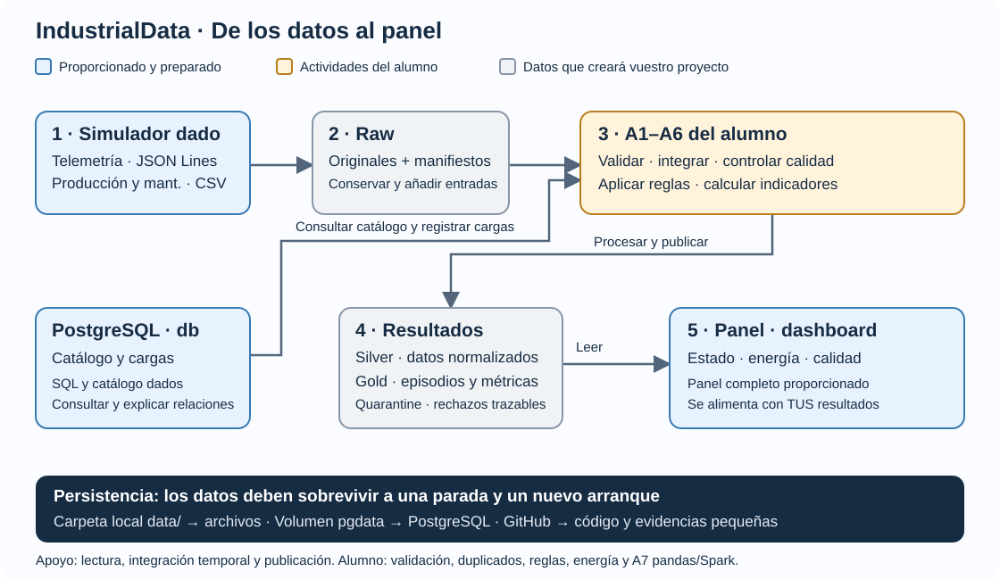
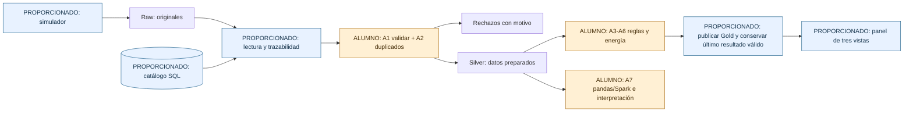

# IndustrialData · Versión guiada individual

**UT1 · SBD · RA1 · IES Ataulfo Argenta · Castro Urdiales**

Construirás una plataforma de datos industrial con seis máquinas, cuatro fuentes, escenarios S01–S08 y un panel de calidad, energía e incidencias. Recibes herramientas y componentes preparados para centrar tu trabajo en el tratamiento de los datos, las pruebas y la interpretación de resultados.

**[Leer el enunciado guiado y la rúbrica](https://iesataulfoargentasor.github.io/industrialdata-ut1-guiado/enunciado.html)** · [Guía de actividades](docs/GUIA.md) · [Requisitos y evidencias](docs/EVIDENCIAS.md)

## 1. Qué recibes y qué completas



| Proporcionado y utilizable | Tu aportación individual |
|---|---|
| Docker, PostgreSQL y persistencia | Explicar servicios y justificar decisiones |
| Simulador reproducible y catálogo SQL | Explorar fuentes y parámetros; verificar los casos |
| Lectura JSON/CSV/SQL, trazabilidad y publicación atómica | A1 validación y normalización; A2 duplicados y conflictos |
| Integración temporal de producción/mantenimiento y agrupador de episodios | A3 umbrales; A4 reglas de consumo y paradas; explicar relaciones |
| Estructura de indicadores y panel completo | A5 integración de energía; A6 intensidad evaluable |
| Infraestructura de experimentos y pruebas | A7 agregación equivalente pandas/Spark; añadir pruebas y analizar mediciones |

El código proporcionado NO acredita que lo hayas escrito. Identifica tu contribución en el informe. El generador incluye los escenarios conocidos para probar: el detector no debe leer `escenarios_esperados.json`.



## 2. Crear TU repositorio

1. Inicia sesión en GitHub y abre [Use this template → Create a new repository](https://github.com/iesataulfoargentasor/industrialdata-ut1-guiado/generate).
2. En **Owner**, selecciona **TU usuario**, no `iesataulfoargentasor`. Nombre sugerido: `industrialdata-guiado`.
3. El resultado será `github.com/TU_USUARIO/industrialdata-guiado`. El profesor proporciona la plantilla; tu copia pertenece a tu cuenta.
4. Puedes hacerlo privado invitando al profesor, o público para tu portfolio. Es individual.
5. Copia la URL de **Code → HTTPS** de TU repositorio y clónala:

```console
git clone https://github.com/TU_USUARIO/industrialdata-guiado.git
cd industrialdata-guiado
```

Sustituye `TU_USUARIO` por tu usuario real. No necesitas `git init` ni cambiar `origin`. La copia no recibe automáticamente futuras actualizaciones de la plantilla. Pages lo publica el profesor; no necesitas activarlo en tu repositorio.

## 3. Arrancar y generar los datos

Necesitas Git, Docker Desktop con motor Linux y conexión para la primera construcción. No necesitas instalar Python o PostgreSQL en Windows. Ejecuta todo desde la carpeta de este README.

En PowerShell, una vez por clon nuevo:

```powershell
Copy-Item .env.example .env
```

En Linux/macOS usa `cp .env.example .env`. Si `.env` ya existe, revísalo sin sobrescribirlo. El puerto por defecto es **8503**, separado de las otras versiones. Cambia `DASHBOARD_PORT` si está ocupado. La contraseña de ejemplo es solo para el entorno local.

```console
docker compose config --quiet
docker compose build pipeline
docker compose up -d --wait db dashboard
docker compose run --rm pipeline python scripts/check_infra.py
docker compose run --rm pipeline python -m pytest -q -m infra
docker compose run --rm simulator
```

Ahora hay seis máquinas, catálogo PostgreSQL y archivos reales en `data/raw/`, generados de forma sintética. El generador predeterminado cubre 24 horas; la llegada tardía está en `data/late/`. Abre [el panel local](http://localhost:8503): todavía no hay resultados publicados. Esto es correcto.

**Resultado inicial esperado:** 4 pruebas de infraestructura pasan. Las pruebas del alumno y del recorrido completo **fallan con `NotImplementedError`** hasta completar las actividades; no son una solución validada ni debes convertirlas en `skip`.

## 4. Completar el procesamiento

Edita `src/industrialdata/alumno.py` siguiendo [A1–A6](docs/GUIA.md). Los archivos están montados dentro de Docker: una ejecución nueva utiliza tus cambios sin reconstruir la imagen. Empieza por los casos pequeños:

```console
docker compose run --rm pipeline python -m pytest tests/test_alumno.py -q -k A1
docker compose run --rm pipeline python -m pytest tests/test_alumno.py -q -k A2
```

Continúa con A3–A6. Para A7 editarás `src/industrialdata/experimentos.py`. Cuando A1–A6 estén listas:

```console
docker compose run --rm pipeline
docker compose run --rm pipeline python -m pytest -q -m integracion
```

Al principio el pipeline termina con código 2 y explica la primera actividad pendiente. No publica resultados ficticios. Cuando lo completes, el panel mostrará tus incidencias, producción, energía y calidad. Recarga la página para leer la última publicación.

El panel recibe un contrato fijo: `current.json` apunta a `snapshots/<run_id>/`, con `silver/telemetry.parquet`, `gold/episodes.parquet`, `gold/metrics.parquet`, `gold/quality.parquet` e informes. La escritura, Avro y el cambio atómico del puntero están proporcionados en `run.py`; evita romper ese contrato.

## 5. Repetición, llegada tardía y persistencia

Repite `docker compose run --rm pipeline`: no debe añadir observaciones ya aceptadas. Después incorpora el lote tardío y vuelve a ejecutar:

```console
docker compose run --rm pipeline python -c "import shutil; shutil.copyfile('/data/late/telemetry_002.jsonl','/data/raw/telemetry_002.jsonl')"
docker compose run --rm pipeline
docker compose run --rm pipeline python scripts/persistence.py before
docker compose down
docker compose up -d --wait db dashboard
docker compose run --rm pipeline python scripts/persistence.py after
```

Esto prueba recreación de contenedores, **no reinicio del motor Docker**. Para comprobar el reinicio de Docker Desktop, toma una captura `before`, reinícialo y espera al motor, levanta servicios y ejecuta `after` sin regenerar datos. Documenta qué hiciste. Nunca uses `down -v` si quieres conservar PostgreSQL.

Los archivos viven en `data/` y SQL en el volumen `industrialdata-guiado_pgdata`. SQL se inicializa al crear un volumen vacío; editar el SQL no migra una base existente. Las otras versiones usan nombres de proyecto distintos. No ejecutes dos copias de esta versión a la vez en un mismo ordenador sin personalizar también proyecto, imagen y puerto.

## 6. Experimentos de UT1

Sigue [la guía de experimentos](docs/EXPERIMENTOS.md) para estudiar complejidad, formatos, 100.000 y un millón de observaciones y comparación pandas/Spark. Los scripts gestionan repetición y medición; tú completas A7, compruebas equivalencia e interpretas resultados. No hay tiempos de referencia inventados.

## 7. Entrega individual

Repositorio personal, commit/etiqueta, README adaptado, notebook ejecutado, informe y vídeo según el enunciado. Declara los módulos proporcionados y enlaza tus cambios. Usa issues, ramas y revisiones propias siguiendo [CONTRIBUTING.md](CONTRIBUTING.md). No subas `.env`, históricos ni resultados privados del profesor.

Dedicación orientativa: **12–14 horas para las actividades principales**. Los experimentos se integran en las sesiones de UT1. El profesor concretará el calendario y las fechas en Moodle.

## 8. Mapa de archivos

```text
src/industrialdata/alumno.py        A1–A6: completar
src/industrialdata/experimentos.py  A7: completar
src/industrialdata/generate.py      Simulador proporcionado
src/industrialdata/ingest.py        Lectura y llamadas a tus funciones
src/industrialdata/analyze.py       Integración temporal y llamadas a tus reglas
src/industrialdata/run.py           Orquestación y publicación proporcionadas
dashboard/app.py                    Panel proporcionado
tests/                             Casos públicos; añade tus propios casos
scripts/                           Herramientas de medición proporcionadas
notebooks/                         Cuaderno guiado de evidencias
docs/                              Enunciado, guía y evidencias
```

Si cambia una dependencia, reconstruye con `docker compose build pipeline` y recrea el panel. Si el generador avisa de datos diferentes, utiliza un nuevo `DATA_ROOT` para el experimento; no borres originales para ocultar el problema.
